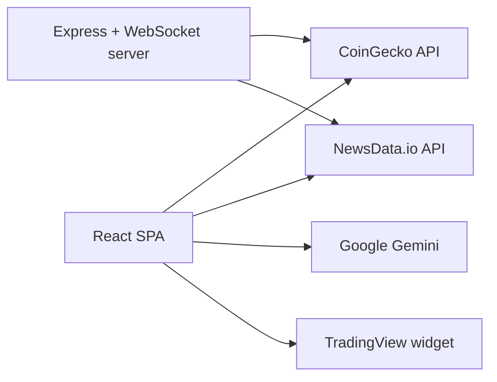

<div align="center">

# CoinSaga

**A React dashboard for cryptocurrency charts, technical indicators, news sentiment and Gemini-generated market commentary.**


</div>

---

## Overview

CoinSaga pulls market data for a selected coin from the CoinGecko API, computes a set of technical indicators in the browser, scores recent headlines from NewsData.io for sentiment, and asks Google Gemini to write a narrative analysis from those inputs. Results are shown in a single-page dashboard alongside an embedded TradingView chart.

The original deployment was at [crypto-sensei.vercel.app](https://crypto-sensei.vercel.app/). It uses CoinGecko's free tier, so you may hit rate limits.

> This is an experimental, educational project. Nothing it shows is financial advice.

## Features

- **Coin watchlist**: BTC, ETH, BNB, ADA and SOL by default. Search CoinGecko to add coins, then toggle, reorder (drag and drop) or remove them. The list is saved in `localStorage`.
- **Live price**: the price refreshes from CoinGecko every 60 seconds. Pick a chart timeframe of 1H, 4H, 1D, 1W or 1M.
- **TradingView chart**: the TradingView widget, loaded from `s3.tradingview.com/tv.js`.
- **Technical indicators**: RSI, Stochastic RSI, MACD (with signal line and histogram), SMA/EMA, ADX, OBV, rate of change, volatility and volume trend, all computed from CoinGecko daily history.
- **Market phase**: classifies the trend as bullish, bearish, sideways, correction or recovery.
- **News sentiment**: headlines from NewsData.io, scored with the `sentiment` library plus keyword and phrase heuristics.
- **AI commentary**: sends a prompt with the indicators, news and sentiment to Gemini (`gemini-pro`) and shows the generated analysis.
- **Risk and strategy panels**: rule-based scores for volatility, trend, volume, news and social risk, plus entry, stop-loss and take-profit levels from `strategyGenerator`.

## Tech stack

| Layer | Technology |
|-------|------------|
| UI | React 18, TypeScript, Vite 4, Tailwind CSS, shadcn-style Radix components, Framer Motion, lucide-react |
| Data | Axios, CoinGecko API, NewsData.io API, TradingView widget |
| Analysis | Custom TypeScript indicator code, `sentiment`, TensorFlow.js |
| AI | `@google/generative-ai` (Gemini) |
| Optional server | Express, `ws` WebSocket server, dotenv |

## Architecture



The UI calls the external APIs directly from the browser. `src/server/index.ts` is a standalone Express server. It has cached, rate-limited proxy endpoints and a WebSocket price feed, but the current UI does not call it.

## Project structure

```
src/
├── App.tsx                  # Dashboard layout and state
├── components/
│   ├── TradingView.tsx      # TradingView widget embed
│   ├── MarketAnalysis.tsx   # Indicators + Gemini commentary
│   ├── AdvancedAnalysis.tsx # Phase, signals, sentiment, risk, strategy
│   ├── NewsPanel.tsx
│   ├── FeaturedCoinsManager.tsx
│   ├── analysis/            # Sub-panels for AdvancedAnalysis
│   └── ui/                  # Button, Card, Input, Select, Switch
├── services/
│   ├── api.ts               # CoinGecko / NewsData clients, caching, sentiment
│   ├── analysis.ts          # Indicators + Gemini prompt
│   ├── advancedAnalysis.ts  # Market phase, signals, risk aggregation
│   ├── ml/models.ts         # TensorFlow.js model definitions
│   ├── risk/ strategy/      # Rule-based risk and strategy generators
│   └── featuredCoins.ts     # Watchlist persisted to localStorage
└── server/index.ts          # Optional Express + WebSocket server
```

## Getting started

**Prerequisites:** Node.js 18+ and npm.

```bash
git clone https://github.com/abhiishek340/CoinSaga.git
cd CoinSaga
npm install
```

Create a `.env` file in the project root:

| Variable | Used by | Description |
|----------|---------|-------------|
| `VITE_GEMINI_API` | Client (`src/services/analysis.ts`) | Google Gemini API key |
| `VITE_NEWSDATA_API_KEY` | Client (`src/services/api.ts`) and server (`src/server/index.ts`) | NewsData.io API key |
| `VITE_PORT` | Server | Port for the Express/WebSocket server (default `3001`) |

Run it:

```bash
npm run dev          # Vite dev server on http://localhost:5173
npm run server:dev   # Optional: Express + WebSocket server (tsx watch)
npm start            # Both at once (concurrently)
npm run build        # Type-check and production build
```

## Limitations

- **"Price predictions" are placeholders.** `api.getPredictions` returns the current price with a random offset and a random confidence value. They are not model output.
- **The TensorFlow.js models are untrained.** `ml/models.ts` defines dense networks, but they are never fitted, so the trend score they produce means nothing. `services/predictions.ts` has an LSTM training pipeline that the UI does not use.
- **The social sentiment score is a random placeholder.**
- **Client-side keys:** the Gemini key and a NewsData key are used in the browser bundle. The NewsData key is read from `VITE_NEWSDATA_API_KEY`; move all keys behind the server before any public deployment.
- The Vite dev proxy and the WebSocket client point to the hosted `crypto-sensei.vercel.app` domain, not to localhost.

---

<div align="center">
Built by <a href="https://github.com/abhiishek340">Abhishek Yadav</a>
</div>
